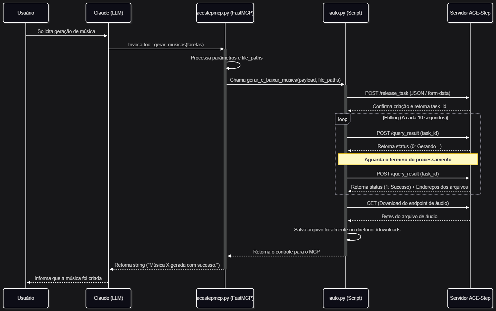

# Diagrama de sequência

# Caso de uso:
## Prompt do Claude

## Parâmetros da geração

## Músicas geradas
<table>
  <tr>
    <td>
      <video src="https://github.com/user-attachments/assets/b416aac4-4989-41ab-a17c-8f280020362c" controls width="130"></video>
    </td>
    <td>
      <video src="https://github.com/user-attachments/assets/20da787b-5a10-48ea-a80f-e48edad1eec4" controls width="130"></video>
    </td>
    <td>
      <video src="https://github.com/user-attachments/assets/b95d0122-7538-4c8d-84f5-9c839a819b05" controls width="130"></video>
    </td>
    <td>
      <video src="https://github.com/user-attachments/assets/5a063eb1-996d-4ee9-a76f-6dd499856709" controls width="130"></video>
    </td>
  </tr>
</table>

## Exemplo com letra
<video src="https://github.com/user-attachments/assets/1fe593dc-504a-4ce5-aefe-80bd3d2a4351" controls width="130"></video>

## Exemplos do modelo padrão (v15-turbo) com inference steps = 20:
<table>
  <td>
    <video src="https://github.com/user-attachments/assets/83cafb74-187e-4ab3-bbff-d0925447088c" controls width="130"></video>
  </td>
  <td>
    <video src="https://github.com/user-attachments/assets/3b230768-5d97-40dd-8101-fbda962bb648" controls width="130"></video>
  </td>
</table>

# Modelos do ACE-Step
**LM de 5Hz (Language Model) — Planejador (Opcional)**

O LM é um "planejador onipotente" responsável por entender sua intenção e elaborar planos:
- Infere metadados musicais (BPM, tom, duração, etc.) por meio de **Cadeia de Pensamento (Chain-of-Thought)**
- Otimiza e expande suas legendas/prompts — compreendendo e complementando sua intenção
- Gera **códigos semânticos** — que contêm implicitamente a melodia da composição, orquestração e algumas informações de timbre

O LM aprende **conhecimento de mundo** a partir dos dados de treinamento. É um planejador que melhora a usabilidade e ajuda a gerar protótipos rapidamente.

**Mas o LM não é obrigatório.**

Se você tem muita clareza sobre o que deseja, ou já possui um objetivo de planejamento definido — pode pular completamente a etapa de planejamento do LM não utilizando o modo `thinking`.

Por exemplo, no **modo Cover**, você utiliza um áudio de referência para restringir a composição, os acordes e a estrutura, deixando o DiT gerar diretamente. Aqui, **você substitui o trabalho do LM** — você mesmo se torna o planejador.

Outro exemplo: no **modo Repaint**, você utiliza um áudio de referência como contexto, restringindo timbre, mixagem e detalhes, deixando o DiT ajustar localmente de forma direta. Aqui, o DiT atua mais como um parceiro de brainstorming criativo, auxiliando na ideação e corrigindo desarmonias locais.

**DiT (Diffusion Transformer) — Executor**

O DiT é o "artesão do áudio", responsável por transformar os planos em realidade:
- Recebe códigos semânticos e condições gerados pelo LM
- "Esculpe" gradualmente o áudio a partir do ruído através do **processo de difusão**
- Define o timbre final, mixagem e detalhes

## Modelos LM

O LM possui quatro opções: **Sem LM** (desativa o modo thinking), **0.6B**, **1.7B**, **4B**.

Os dados de treinamento são completamente idênticos; a diferença está puramente na **capacidade de conhecimento**:
- Modelos maiores possuem um conhecimento de mundo mais rico
- Modelos maiores têm memória mais forte (ex.: lembrar melodias de áudios de referência)
- Modelos maiores se saem relativamente melhor em estilos ou instrumentos de cauda longa (long-tail)

| Escolha | Velocidade | Conhecimento de Mundo | Memória | Casos de Uso |
|---------|:----------:|:---------------------:|:-------:|--------------|
| Sem LM | ⚡⚡⚡⚡ | — | — | Você faz o planejamento (ex.: modo Cover) |
| `0.6B` | ⚡⚡⚡ | Básico | Fraca | Pouca VRAM (< 8GB), prototipagem rápida |
| `1.7B` | ⚡⚡ | Médio | Média | **Recomendação padrão** |
| `4B` | ⚡ | Rico | Forte | Tarefas complexas, geração de alta qualidade |

**Como escolher?**

Com base no seu hardware:
- **VRAM < 8GB** → Sem LM ou `0.6B`
- **VRAM 8–16GB** → `1.7B` (padrão)
- **VRAM > 16GB** → `1.7B` ou `4B`

## Escolhendo o Executor: Modelos DiT

Com um esquema de planejamento definido, você ainda precisa escolher um executor. O DiT é o núcleo do ACE-Step 1.5 — ele gerencia várias tarefas e decide como interpretar os códigos gerados pelo LM.

### Série Turbo (Recomendada para Uso Diário)

Os modelos Turbo são treinados com destilação, gerando áudio de alta qualidade em apenas 8 passos. A diferença fundamental entre as quatro variantes é a **configuração do hiperparâmetro de shift durante a destilação**.

**O que é shift?**

O shift determina a "alocação de atenção" durante a remoção de ruído (denoising) do DiT:
- **Shift maior** → Mais esforço gasto na remoção inicial de ruído (construindo a estrutura ampla a partir do ruído puro), **semântica mais forte**, estrutura geral mais clara
- **Shift menor** → Distribuição de passos mais uniforme, **mais detalhes**, mas esses detalhes também podem conter ruído

Entendimento simples: shift alto é como "desenhar o contorno primeiro para depois preencher os detalhes", shift baixo é como "desenhar e ajustar simultaneamente".

| Modelo | Config. de Destilação | Características |
|--------|-----------------------|-----------------|
| `turbo` (padrão) | Destilação conjunta nos shifts 1, 2, 3 | **Melhor equilíbrio entre criatividade e semântica**, amplamente testado, primeira opção recomendada |
| `turbo-shift1` | Destilado apenas no shift=1 | Detalhes mais ricos, porém semântica mais fraca |
| `turbo-shift3` | Destilado apenas no shift=3 | Timbre mais claro e rico, mas pode soar "seco", orquestração mínima |
| `turbo-continuous` | Experimental, suporta shift contínuo 1–5 | Ajuste mais flexível, mas não testado exaustivamente |

### Modelo SFT

Comparado ao Turbo, o modelo SFT possui duas características notáveis:
- **Suporta CFG** (Classifier-Free Guidance), permitindo ajuste fino da aderência ao prompt
- **Mais passos** (50 passos), dando mais tempo para o modelo "pensar"

O custo: mais passos significam acúmulo de erros, e a clareza do áudio pode ser ligeiramente inferior ao Turbo. No entanto, sua **expressão de detalhes e interpretação semântica serão superiores**.

Se você não se importa com o tempo de inferência, gosta de ajustar CFG e passos, e prefere aquela sensação de detalhes ricos — o SFT é uma boa escolha. Os códigos gerados pelo LM também funcionam com modelos SFT.

### Modelo Base

O Base é o **mestre de todas as tarefas**, possuindo três tarefas exclusivas além do SFT e do Turbo:

| Tarefa | Descrição |
|--------|-----------|
| `extract` | Extrair faixas individuais de um áudio mixado (ex.: separar vocais) |
| `lego` | Adicionar novas faixas a faixas existentes (ex.: adicionar bateria à guitarra) |
| `complete` | Adicionar acompanhamento mixado a uma faixa única (ex.: adicionar acompanhamento de guitarra+bateria aos vocais) |

Além disso, o Base possui a **maior plasticidade**. Se você tem necessidades de ajuste fino (fine-tuning) em grande escala, recomendamos iniciar os experimentos com o Base para treinar seu próprio modelo SFT.

### Modelos XL (4B)

Os modelos XL utilizam um decodificador DiT maior, de 4B de parâmetros, para alcançar maior qualidade de áudio. Eles vêm nas mesmas três variantes (base, sft, turbo) e se comportam de forma idêntica — apenas com melhor qualidade de geração. **Todos os modelos LM (0.6B / 1.7B / 4B) são totalmente compatíveis com o XL.**

**Requisitos:** Os modelos XL precisam de ~9GB de VRAM para os pesos (contra ~4.7GB para o 2B). Mínimo de 12GB de VRAM com offload + quantização, recomendado 20GB+.

| Modelo XL (nome completo) | Passos | CFG | VRAM | Notas |
|---------------------------|:------:|:---:|:----:|-------|
| `acestep-v15-xl-turbo` | 8 | ❌ | ≥12GB | Rápido + alta qualidade, melhor opção diária em GPUs de 20GB+ |
| `acestep-v15-xl-sft` | 50 | ✅ | ≥12GB | Altíssima qualidade, CFG ajustável |
| `acestep-v15-xl-base` | 50 | ✅ | ≥12GB | Todas as tarefas, incluindo extract/lego/complete |

## Resumo de Seleção do DiT

| Modelo | Passos | CFG | Velocidade | Tarefas Exclusivas | Cenários Recomendados |
|--------|:------:|:---:|:----------:|-------------------|-----------------------|
| `turbo` (padrão) | 8 | ❌ | ⚡⚡⚡ | — | Uso diário, iteração rápida |
| `sft` | 50 | ✅ | ⚡ | — | Busca por detalhes, gosta de ajustes finos |
| `base` | 50 | ✅ | ⚡ | extract, lego, complete | Tarefas especiais, fine-tuning em grande escala |
| **`acestep-v15-xl-turbo`** | 8 | ❌ | ⚡⚡ | — | Melhor escolha diária em GPUs de 20GB+ |
| **`acestep-v15-xl-sft`** | 50 | ✅ | ⚡ | — | Altíssima qualidade, ≥12GB VRAM |
| **`acestep-v15-xl-base`** | 50 | ✅ | ⚡ | extract, lego, complete | Todas as tarefas com maior qualidade, ≥12GB VRAM |
"""

